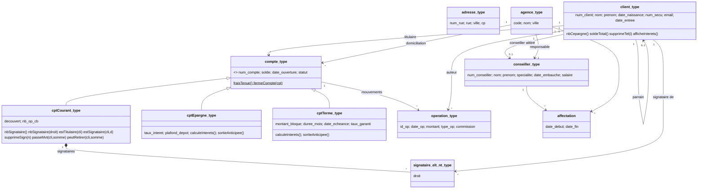

# Étape 0 — Cadrage, conception et plan de travail

**Mini-projet BDDA — M1 ASR — Université de Bejaia — 2026/2027**
**Sujet :** gestion d'une banque (clients, comptes, opérations) en Oracle relationnel-objet.
**Base cible :** Oracle Database 21c Express Edition, PDB `XEPDB1`, schéma `MASTER1`.

---

## 0.1 Démarche en 7 étapes

| # | Étape | Contenu | Fichier produit |
|---|-------|---------|-----------------|
| 0 | Cadrage | Compréhension, choix, ambiguïtés, plan | ce document |
| 1 | Conception | Diagramme UML complet (A1) | `uml/` |
| 2 | Schéma | Utilisateur, types, tables, contraintes, régénération (A2–A3) | `00_creation_utilisateur.sql`, `partie_A_schema.sql` |
| 3 | Données | Jeu de test A4 (3 agences, 4 conseillers, 6 clients, 7 CC, 5 CE, 3+1 CT, 20 opérations) | `partie_A_schema.sql` (section données) |
| 4 | Manipulation | B5a–B5f | `partie_B_manipulation.sql` |
| 5 | Requêtes | C6.1–C6.25 | `partie_C_requetes.sql` |
| 6 | Programmation | D7, D8, D9, E10–E12 | `partie_D_plsql.sql`, `partie_E_avance.sql` |
| 7 | Intégration | Rejeu complet, guide, captures | `projet_bdda_banque.sql`, `GUIDE_SOUTENANCE.md` |

Chaque fichier est exécuté seul avec
`sqlplus -S -L MASTER1/<mot_de_passe>@localhost:1521/XEPDB1 @fichier.sql`,
puis relu : toute erreur ORA est corrigée avant de passer à la suite.
Le script final est rejoué **de zéro** sur un schéma vide avant livraison.

---

## 0.2 Périmètre exact du sujet

Trois volets métier :

1. **Clients / conseillers / agences** : client (identité, adresse objet, VARRAY de 3 téléphones, e-mail, date d'entrée, conseiller attitré, parrain récursif) ; conseiller (spécialité, embauche, salaire) ; agence (code, nom, ville, responsable) ; historique des affectations conseiller ↔ agence.
2. **Comptes** : `compte_type` **NOT FINAL NOT INSTANTIABLE**, trois sous-types `UNDER` (courant, épargne, à terme). Aucun compte générique. Signataires en *nested table* avec droit `R`/`D`/`X`.
3. **Opérations** : uniquement sur compte courant, montant signé, type `DEPOT`/`RETRAIT`/`VIREMENT`/`CB`, commission.

Éléments programmables : 2 fonctions cataloguées (nb comptes, solde total), 1 fonction ville, 4 procédures (`ajout_client`, `drop_client`, `change_Portable`, `virement`), 14 méthodes (dont 1 `STATIC` et 1 paire surchargée), 6 triggers, 1 table d'audit, 1 table d'alerte, 1 type récursif, 1 collection multi-niveaux, 1 vue objet.

---

## 0.3 Environnement vérifié (faits, pas suppositions)

| Point | Constat |
|-------|---------|
| Version | Oracle Database 21c XE **21.3.0.0.0**, CDB `XE`, PDB `XEPDB1` |
| Schéma | `MASTER1` existe, ouvert, mot de passe opérationnel `system` |
| Privilèges | `CREATE SESSION/TABLE/TYPE/VIEW/PROCEDURE/SEQUENCE/TRIGGER`, quota **illimité** sur `USERS` |
| État actuel | schéma **vide**, corbeille **vide** (vérifié en fin de cadrage) |
| Droits DBA | aucun ; aucune connexion `SYSTEM`/`SYS` effectuée |

Comportements Oracle réellement testés sur cette base (ils dictent la conception) :

| # | Test | Résultat | Conséquence |
|---|------|----------|-------------|
| 1 | `CREATE TYPE` direct dans SQL*Plus | la session se ferme sans message | encapsuler dans `EXECUTE IMMEDIATE` |
| 2 | `ALTER TYPE ... ADD ATTRIBUTE ref_parrain REF client_type CASCADE` | OK, puis double notation `c.ref_parrain.ref_parrain.nom` OK | A4 et E10 réalisables |
| 3 | `FOREIGN KEY` sur une colonne `REF` | OK **et réellement vérifiée** (`ORA-02292`) | « intégrité référentielle sur les REF » = vraie FK |
| 4 | FK sur la table de stockage d'une nested table | **`ORA-30730` interdit** | signataires : intégrité applicative |
| 5 | Trigger sur table de stockage d'une nested table | **`ORA-22812` interdit** | pas de trigger sur les signataires |
| 6 | `OBJECT IDENTIFIER IS PRIMARY KEY` | exige `(colonne PRIMARY KEY)` | syntaxe exacte connue |
| 7 | `MAKE_REF` | exige une table à OID primaire | **agence** en OID primaire |
| 8 | `REF` d'une table à OID primaire dans une nested table | **`ORA-22979`** | **client** en OID système |
| 9 | `CHECK ... DEFERRABLE INITIALLY DEFERRED` | OK (insert NULL puis UPDATE) | résout la contradiction B5b |
| 10 | `CHECK` sur nested table via `ALTER TABLE` | OK (`ORA-02290` sur violation) | contrainte `droit IN ('X','R','D')` |
| 11 | `ALTER TYPE ADD MEMBER/PROCEDURE/STATIC/`surcharge | OK ; corps `INVALID` puis `VALID` après `CREATE OR REPLACE TYPE BODY` | D8 entièrement faisable |
| 12 | Corps d'un sous-type | mot-clé **`OVERRIDING`** obligatoire (`PLS-00538/00539`) | piège évité |
| 13 | Trigger `COMPOUND` pour le plafond journalier | 150 000 accepté, puis 60 000 refusé (total 210 000) | pas d'`ORA-04091` |
| 14 | Vue objet `CAST(MULTISET(...))` + `MAKE_REF` + 3 requêtes `TABLE` | OK | E12 validé d'avance |

---

## 0.4 Modèle retenu

### Types (ordre de création)

```sql
-- Adresse et téléphones
adresse_type      AS OBJECT (num_rue NUMBER, rue VARCHAR2(80), ville VARCHAR2(40), cp VARCHAR2(10))
tel_vry_type      AS VARRAY(3) OF VARCHAR2(20)          -- domicile, portable 1, portable 2

-- Individus et structures
conseiller_type   AS OBJECT (num_conseiller, nom, prenom, specialite, date_embauche, salaire)
agence_type       AS OBJECT (code, nom, ville, ref_responsable REF conseiller_type)
client_type       AS OBJECT (num_client, nom, prenom, date_naissance, num_secu,
                             adresse adresse_type, telephones tel_vry_type,
                             email, date_entree, ref_conseiller REF conseiller_type)
-- puis : ALTER TYPE client_type ADD ATTRIBUTE ref_parrain REF client_type CASCADE

-- Signataires (nested table)
signataire_elt_nt_type AS OBJECT (ref_client REF client_type, droit CHAR(1))
signataire_nt_type     AS TABLE OF signataire_elt_nt_type

-- Hiérarchie des comptes
compte_type       AS OBJECT (num_compte, solde, date_ouverture, statut,
                             ref_client REF client_type, ref_agence REF agence_type,
                             MEMBER FUNCTION fraisTenue RETURN NUMBER)
                  NOT FINAL NOT INSTANTIABLE
cptCourant_type   UNDER compte_type (decouvert, nb_op_cb, signataires signataire_nt_type,
                                     OVERRIDING MEMBER FUNCTION fraisTenue RETURN NUMBER)
cptEpargne_type   UNDER compte_type (taux_interet, plafond_depot,
                                     OVERRIDING MEMBER FUNCTION fraisTenue RETURN NUMBER)
cptTerme_type     UNDER compte_type (montant_bloque, duree_mois, date_echeance, taux_garanti,
                                     OVERRIDING MEMBER FUNCTION fraisTenue RETURN NUMBER)

-- Opérations
operation_type    AS OBJECT (id_op, ref_client REF client_type, ref_compte REF cptCourant_type,
                             date_op, montant, type_op, commission)

-- Multi-niveaux (E11)
type_stat_elt_nt_type AS OBJECT (type_op, nb, montant_total)
type_stat_nt_type     AS TABLE OF type_stat_elt_nt_type
mois_elt_vry_type     AS OBJECT (mois, nb_operations, types type_stat_nt_type)
mois_vry_type         AS VARRAY(12) OF mois_elt_vry_type

-- Vue objet (E12)
agence_vor_type   AS OBJECT (code, nom,
                             conseillers conseiller_nt_type,
                             comptes cptCourant_nt_type)
```

*Ce que ça fait :* fixe l'ordre de création (les dépendances sont respectées : `conseiller` avant `agence` et `client`, `type_stat` avant `mois`).
*Résultat attendu :* chaque `CREATE TYPE` passe ; les sous-types héritent des 6 attributs communs.
*Erreur possible :* `ORA-02249`/`ORA-04055` si l'ordre est inversé ; `PLS-00538` si `OVERRIDING` est oublié dans un corps de sous-type.

### Tables

| Table | Nature | Clé / OID | Remarque |
|-------|--------|-----------|----------|
| `conseiller` | table objet | PK `num_conseiller`, OID système | |
| `agence` | table objet | `(code PRIMARY KEY) OBJECT IDENTIFIER IS PRIMARY KEY` | requis par `MAKE_REF` |
| `client` | table objet | PK `num_client`, UNIQUE `num_secu`, **OID système** | REF insérable dans la nested table |
| `affectation` | table relationnelle | PK `id_affectation` | historique conseiller ↔ agence |
| `cpt_courant` | table objet | PK `num_compte` + `NESTED TABLE signataires STORE AS ...` | |
| `cpt_epargne` | table objet | PK `num_compte` | |
| `cpt_terme` | table objet | PK `num_compte` | |
| `operation` | table objet | PK `id_op` | |
| `alerte` | table relationnelle | PK `id_alerte` | notifications |
| `audit` | table relationnelle | PK `id_audit` | traçabilité |
| `releves` | table relationnelle | PK `annee` | VARRAY de 12 mois |

*Ce que ça fait :* une table par sous-type (aucune table `compte` générique), conforme à « la banque ne gère jamais de compte générique ».
*Résultat attendu :* `SELECT COUNT(*) FROM cpt_courant` etc. fonctionnent indépendamment ; `REF(client)` reste stockable en collection.
*Erreur possible :* `ORA-22856` si l'on tente `ALTER TABLE` pour ajouter une colonne à une table objet (interdit) → il faut `ALTER TYPE ... CASCADE`.

### Esquisse UML (le diagramme complet est livré en A1)



*Ce que ça fait :* montre héritage, cardinalités, classe d'association des signataires (avec `droit`), association n-aire des opérations, récursivité du parrainage, agrégation des téléphones et méthodes.
*Résultat attendu :* le diagramme couvre les 7 exigences de A1.
*Erreur possible :* aucune (document).

---

## 0.5 Choix de conception

**D1 — Tables objet pour les entités, tables relationnelles pour les historiques.**
`agence`, `conseiller`, `client`, les 3 comptes et `operation` sont des tables objet (`OF type`). `affectation`, `alerte`, `audit`, `releves` sont relationnelles : ce sont des journaux, pas des entités du modèle.

**D2 — Hiérarchie stricte, aucune table générique.**
`compte_type` est `NOT FINAL NOT INSTANTIABLE` ; les 3 sous-types sont `UNDER`. On crée 3 tables objet, jamais de table `compte`. Les requêtes « tous les comptes » passent par `UNION ALL` (C6.5, C6.11, C6.15, `soldeTotal`).

**D3 — Un seul REF par relation, avec FK réelle.**
Chaque `REF` de premier niveau (colonne de table objet ou relationnelle) reçoit une vraie `FOREIGN KEY` : Oracle la vérifie (test #3). C'est la réponse littérale à « intégrité référentielle sur les REF ». Les `REF` internes aux nested tables ne peuvent pas recevoir de FK (`ORA-30730`) : voir H9.

**D4 — Agence en OID primaire, client en OID système.**
`MAKE_REF(agence, code)` (E12) impose `OBJECT IDENTIFIER IS PRIMARY KEY` sur `agence`. À l'inverse, un `REF` issu d'une table à OID primaire ne peut pas entrer dans une nested table (`ORA-22979`) : `client` garde donc un OID système, ce qui permet `REF(client)` dans `signataires`.

**D5 — Signataires : nested table d'objets, pas de table de jointure.**
`signataire_elt_nt_type(ref_client, droit)` + `NESTED TABLE signataires STORE AS signataire_nt_st`. La contrainte `droit IN ('X','R','D')` est ajoutée **sur la table de stockage** par `ALTER TABLE` (test #10), comme demandé.

**D6 — Téléphones : `VARRAY(3) OF VARCHAR2(20)`.**
Scalaire et non objet, pour que `COUNT(numTel)` (C6.16) compte les numéros renseignés et que `t.telephones(2)` (D7a) reste naturel. La convention `xxx_elt_vry_type` s'applique aux VARRAY d'objets (`mois_elt_vry_type` en E11).

**D7 — Parrainage ajouté par `ALTER TYPE ... CASCADE`.**
`client_type` est créé sans `ref_parrain`, puis l'attribut est ajouté (A, avant insertion des données) pour respecter A4 (« 2 clients parrainés ») ; E10 rejoue l'ajout de façon idempotente et démontre la double notation. Voir H1.

**D8 — Historique des affectations dans une table dédiée.**
`conseiller_type` ne porte pas d'agence ; `affectation(ref_conseiller, ref_agence, date_debut, date_fin)` porte l'historique. La mutation (E12) ferme l'affectation courante (`date_fin = SYSDATE`) et en ouvre une nouvelle.

**D9 — Opérations uniquement sur comptes courants.**
`operation_type.ref_compte REF cptCourant_type` : le typage rend l'interdiction structurelle, pas seulement applicative. Les mouvements d'épargne/terme passent par les méthodes et les triggers de solde.

**D10 — Le solde est dérivé, jamais saisi deux fois.**
Un trigger `AFTER INSERT` sur `operation` met à jour `solde` (`+ montant - commission`) et le compteur CB. `passeMvt` **délègue** au trigger : elle insère l'opération, elle ne met pas le solde à jour elle-même (sinon double comptage). Voir H4.

**D11 — Plafond journalier en trigger `COMPOUND`.**
`BEFORE STATEMENT` photographie les retraits du jour par compte (associatif `INDEX BY VARCHAR2`), `BEFORE EACH ROW` cumule et refuse au-delà de 200 000 DA. Un trigger `FOR EACH ROW` seul lirait la table en mutation (`ORA-04091`) ; le compound est la solution canonique (test #13).

**D12 — DORMANT par procédure, pas par trigger.**
« Plus de 12 mois sans opération » n'est pas un événement : c'est un balayage. `maj_statuts_dormants` fait l'`UPDATE`, un job `DBMS_SCHEDULER` optionnel l'automatise. Aucun trigger ne peut détecter l'absence d'événement.

**D13 — Alertes idempotentes.**
Table `alerte` + trigger sur `cpt_terme` (échéance ≤ 8 jours ou dépassée) + trigger sur `operation` (> 1 000 000 DA, solde négatif). Les insertions sont protégées par `NOT EXISTS` pour ne pas dupliquer à chaque `UPDATE`/rejeu.

**D14 — Audit par triggers `AFTER UPDATE OF`.**
`AFTER UPDATE OF decouvert ON cpt_courant` et `AFTER UPDATE OF taux_interet ON cpt_epargne` insèrent dans `audit` (ancienne valeur, nouvelle valeur, date, utilisateur). Oracle accepte `UPDATE OF <attribut>` sur une table objet (testé).

**D15 — CHECK différé pour B5b.**
`CHECK (ref_client IS NOT NULL) DEFERRABLE INITIALLY DEFERRED` sur `cpt_courant` : on peut insérer CC99 sans titulaire puis l'associer par `UPDATE` dans la même transaction (test #9), tout en conservant la contrainte exigée en A3.

**D16 — `fraisTenue` déclarée dès la création.**
Une méthode redéfinie ne peut pas être ajoutée par `ALTER TYPE` (`ORA-22324`/`PLS-00636`). `fraisTenue` est donc déclarée `OVERRIDING` dans les 3 sous-types dès A, avec son corps. Les autres méthodes sont ajoutées en D par `ALTER TYPE ... ADD MEMBER ... CASCADE` (test #11).

**D17 — Un trigger `AFTER INSERT` unique sur `operation`.**
Mettre à jour le solde et lire le solde pour l'alerte « négatif » dans deux triggers séparés est non déterministe (ordre d'exécution non garanti). Un seul trigger fait les deux, dans l'ordre.

**D18 — `virement` atomique par `SAVEPOINT`.**
Deux insertions (débit source, crédit destination) dans un `SAVEPOINT` ; toute erreur fait `ROLLBACK TO` et relance. Le `COMMIT` reste à l'appelant, pour que la procédure soit composable ; le script de test commite explicitement.

**D19 — Vue objet conforme à la lettre de E12.**
`agence_vor_type` contient deux nested tables d'objets ; la vue utilise `CAST(MULTISET(...))` **et** `MAKE_REF(agence, a.code)` comme corrélation. Validé sur cette base (test #14).

**D20 — Rejeu garanti.**
Chaque fichier commence par les `SET` demandés, un bloc de `DROP` ordonné (`WHENEVER SQLERROR CONTINUE`), puis la création. Le script maître enchaîne A→E et se termine par un état vérifiable.

---

## 0.6 Ambiguïtés du sujet et hypothèses retenues

**H1 — A4 (« 2 clients parrainés ») contredit E10 (attribut ajouté seulement en E).**
Impossible d'insérer un parrain avant que l'attribut existe. *Retenu :* l'`ALTER TYPE ... CASCADE` est exécuté en A, juste après la création du type et avant les insertions ; E10 le rejoue sous garde (`user_type_attrs`) et démontre la double notation. Le script reste rejouable.

**H2 — B5b (« CC99 sans titulaire ») contredit A3 (`CHECK (ref_client IS NOT NULL)`).**
*Retenu :* contrainte `DEFERRABLE INITIALLY DEFERRED` sur `cpt_courant` (test #9). Elle est bien NOT NULL, mais contrôlée au `COMMIT`.

**H3 — « Les dépôts d'épargne ne peuvent pas dépasser le plafond » alors que les opérations sont réservées aux comptes courants.**
*Retenu :* un trigger `BEFORE INSERT OR UPDATE OF solde ON cpt_epargne` refuse `solde > plafond_depot`. Aucune opération n'est créée sur un compte d'épargne, le modèle du volet 3 est respecté.

**H4 — Où est prélevée la commission de virement ?**
*Retenu :* `commission = GREATEST(100, 0.01 × |montant|)` sur l'opération de débit, `0` sur le crédit ; le solde varie de `montant - commission`. La commission est donc prélevée sur le compte source et visible dans l'opération.

**H5 — Périmètre du plafond de 200 000 DA.**
*Retenu :* somme des `RETRAIT` (montant < 0) d'un même compte, même jour (`TRUNC(date_op)`), **hors commission**. Les `CB` ne sont pas comptés, lecture littérale de « retraits ».

**H6 — Formule des intérêts.**
`solde × (1 + taux/100)` est le **capital capitalisé**, pas l'intérêt. *Retenu :* `calculeInterets` renvoie ce capital ; l'intérêt affiché vaut `solde × taux/100`. Pour le terme : `solde × (1 + taux/100 × durée_mois/12)`.

**H7 — `sortieAnticipee` sur un compte d'épargne.**
Un compte d'épargne n'a pas d'échéance. *Retenu :* pénalité de 5 % appliquée au solde (`solde × 0.95`) ; sur le compte à terme, 5 % du montant bloqué.

**H8 — Compte DORMANT.**
Aucun trigger ne peut détecter une absence d'opération. *Retenu :* procédure `maj_statuts_dormants` (balayage), job optionnel, et requête C6.23 en lecture.

**H9 — Intégrité des `REF` des signataires.**
`ORA-30730` interdit la FK et `ORA-22812` interdit le trigger sur la table de stockage. *Retenu :* intégrité assurée par les procédures d'écriture (`ajout_client`, `drop_client`, insertion des signataires) + une requête de contrôle documentée. Les autres `REF` ont une vraie FK.

**H10 — Unicité du numéro de compte entre les 3 tables.**
Trois tables distinctes ⇒ trois PK locales. *Retenu :* préfixes `CC`/`CE`/`CT` + contrôle applicatif ; documenté comme limite du modèle objet (pas de table mère).

**H11 — C6.25 ne supprime rien avec les seules données de A4.**
A4 demande 3 comptes à terme ; aucun n'a simultanément « échéance dépassée de plus d'un an » et « montant bloqué nul ». *Retenu :* un 4ᵉ compte `CT4` (échéance −400 jours, montant bloqué 0) est ajouté au jeu de test ; C6.25 supprime alors exactement 1 ligne.

**H12 — Alerte « 8 jours avant, puis à nouveau si dépassée ».**
*Retenu :* deux types (`ECHEANCE_PROCHE` si `0 ≤ échéance − SYSDATE ≤ 8`, `ECHEANCE_DEPASSEE` si `< 0`), insertion idempotente, plus une procédure `scan_echeances` pour les comptes déjà en base.

**H13 — Opérations d'un client supprimé sur les comptes d'autrui.**
La FK `operation.ref_client` empêcherait la suppression. *Retenu :* `drop_client` supprime aussi les opérations que ce client a faites ailleurs (traçabilité sacrifiée, cohérence référentielle conservée) ; documenté.

**H14 — Mot de passe et CREATE USER.**
`MASTER1` existe déjà : le script de création (question 2) est **fourni mais non exécuté**, et rendu idempotent. Les scripts supposent `MASTER1/system` ; à remplacer par le mot de passe réel lors du rendu.

---

## 0.7 Trois points à valider

1. **H1 (parrainage)** : ajouter `ref_parrain` en A (via `ALTER TYPE ... CASCADE`) pour pouvoir insérer les 2 clients parrainés de A4, puis rejouer l'ajout en E10 sous garde. *Alternative :* créer les 6 clients sans parrain en A et ne parrainer qu'en E (mais A4 ne serait plus littéralement respecté). → **je retiens la première option.**
2. **H2 (CC99)** : `CHECK (ref_client IS NOT NULL) DEFERRABLE INITIALLY DEFERRED`. *Alternative :* insérer CC99 avec un `REF` temporaire puis `UPDATE`. → **je retiens la contrainte différée.**
3. **H11 (C6.25)** : ajouter un 4ᵉ compte à terme `CT4` pour que la suppression de C6.25 affecte une ligne. *Alternative :* ne rien supprimer et l'expliquer. → **je retiens le 4ᵉ compte.**

Répondez **« continue »** pour que j'applique ces trois choix par défaut, ou indiquez celui à changer. Je passe ensuite à la **Partie A** (UML + création du schéma + données).

---

## 0.8 Plan des fichiers

```
D:\bdda\
├── 00_creation_utilisateur.sql     -- question 2, à exécuter par le DBA (non exécuté ici)
├── partie_A_schema.sql             -- A1 (renvoi UML), A2, A3, A4 + DROP/DELETE de régénération
├── partie_B_manipulation.sql       -- B5a → B5f
├── partie_C_requetes.sql           -- C6.1 → C6.25
├── partie_D_plsql.sql              -- D7a→e, D8a→n, D9 (triggers)
├── partie_E_avance.sql             -- E10, E11, E12
├── projet_bdda_banque.sql          -- script unique : A→E, rejouable de zéro
├── GUIDE_SOUTENANCE.md             -- 8 sections, ≥ 25 Q/R, démo 10 min
├── CAPTURES_A_FAIRE.md             -- liste ordonnée des captures pour le rapport PDF
├── ETAPE_0_CADRAGE.md              -- ce document
├── sujet.txt                       -- texte extrait du PDF (source de vérité)
├── Mini-projet BDDA-sujet02-20262027.pdf
└── uml\
    ├── banque.puml                 -- PlantUML
    ├── banque.mermaid              -- Mermaid
    └── banque.txt                  -- description textuelle
```

Règles communes à tous les `.sql` :

```sql
SET SERVEROUTPUT ON SIZE UNLIMITED
SET LINESIZE 200
SET PAGESIZE 100
SET DEFINE OFF
```

*Ce que ça fait :* active `DBMS_OUTPUT`, évite les retours à la ligne parasites, désactive la substitution `&`.
*Résultat attendu :* sorties lisibles, aucun `SP2-0552` sur les `&`.
*Erreur possible :* `SP2-0734` si un `/` manque après un bloc PL/SQL.

---

## 0.9 Check-list de couverture

| Question | Fichier | Contenu prévu | Statut |
|----------|---------|---------------|--------|
| A1 | `uml/` | diagramme de classes complet (7 exigences) | à produire |
| A2 | `00_creation_utilisateur.sql` | `CREATE USER`, privilèges, quota | à produire |
| A3 | `partie_A_schema.sql` | types, tables, PK/UNIQUE, CHECK, FK, `STORE AS`, DROP/DELETE | à produire |
| A4 | `partie_A_schema.sql` | 3 agences, 4 conseillers, 6 clients (2 parrainés), 7 CC, 5 CE, 3+1 CT, 20 opérations | à produire |
| B5a | `partie_B_manipulation.sql` | client 99, VARRAY à 1 élément | à produire |
| B5b | idem | CC99 sans titulaire puis `UPDATE` | à produire |
| B5c | idem | opération 50 000 sans date (défaut `SYSDATE`) | à produire |
| B5d | idem | `INSERT INTO TABLE(...)` signataire droit D | à produire |
| B5e | idem | `change_Portable` avant/après | à produire |
| B5f | idem | `drop_client(99)` avant/après | à produire |
| C6.1–6.3 | `partie_C_requetes.sql` | listes clients / CC / CE + CT | à produire |
| C6.4–6.10 | idem | références, jointures implicites, UNION, CC7 | à produire |
| C6.11–6.15 | idem | agrégats, `HAVING`, top 3 | à produire |
| C6.16–6.20 | idem | `TABLE()`, `COUNT(*)` vs `COUNT(col)`, nested cursor | à produire |
| C6.21–6.25 | idem | recherche par ville, échéances, 12 mois, > 1 M, suppression | à produire |
| D7a–D7e | `partie_D_plsql.sql` | 5 blocs anonymes (VARRAY, curseurs, exceptions) | à produire |
| D8a–D8d | idem | méthodes `client_type` | à produire |
| D8e–D8k | idem | méthodes `cptCourant_type` (dont surcharge, `passeMvt`, `fraisTenue`) | à produire |
| D8l–D8m | idem | `calculeInterets`, `sortieAnticipee` | à produire |
| D8n | idem | `STATIC fermeCompte` (CE4, CC1, inexistants) | à produire |
| D9 | idem | 6 triggers + jeux de test + anti-mutation | à produire |
| E10 | `partie_E_avance.sql` | type récursif, double notation | à produire |
| E11 | idem | `releves` multi-niveaux + bloc d'ajout + agrégat annuel | à produire |
| E12 | idem | vue objet + 3 requêtes `TABLE` + méthode `mutation` | à produire |
| Livrable | `projet_bdda_banque.sql` | rejeu A→E sans erreur | à produire |
| Livrable | `GUIDE_SOUTENANCE.md` | 8 sections, ≥ 25 Q/R, démo 10 min | à produire |
| Livrable | `CAPTURES_A_FAIRE.md` | captures pour le rapport PDF | à produire |

---

## 0.10 Points de vigilance pour la suite

- Ne jamais créer un `TYPE` hors `EXECUTE IMMEDIATE` (fermeture silencieuse de session).
- Toujours `OVERRIDING` dans le corps d'un sous-type.
- Ne pas ajouter de colonne à une table objet : passer par `ALTER TYPE ... CASCADE`.
- `DROP TYPE ... FORCE` après les tables, dans l'ordre inverse des dépendances.
- Vérifier `USER_OBJECTS.STATUS = 'VALID'` après chaque `ALTER TYPE` (le corps devient `INVALID` jusqu'au `CREATE OR REPLACE TYPE BODY`).
- Rejouer le script maître sur schéma vide avant toute livraison.
